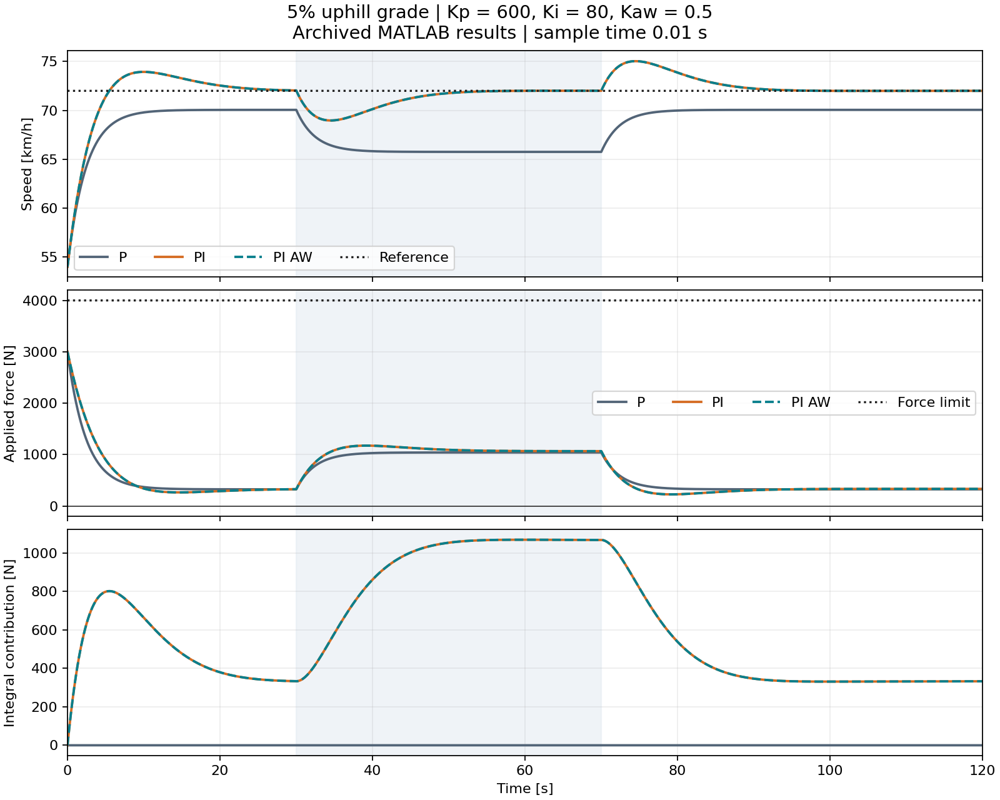
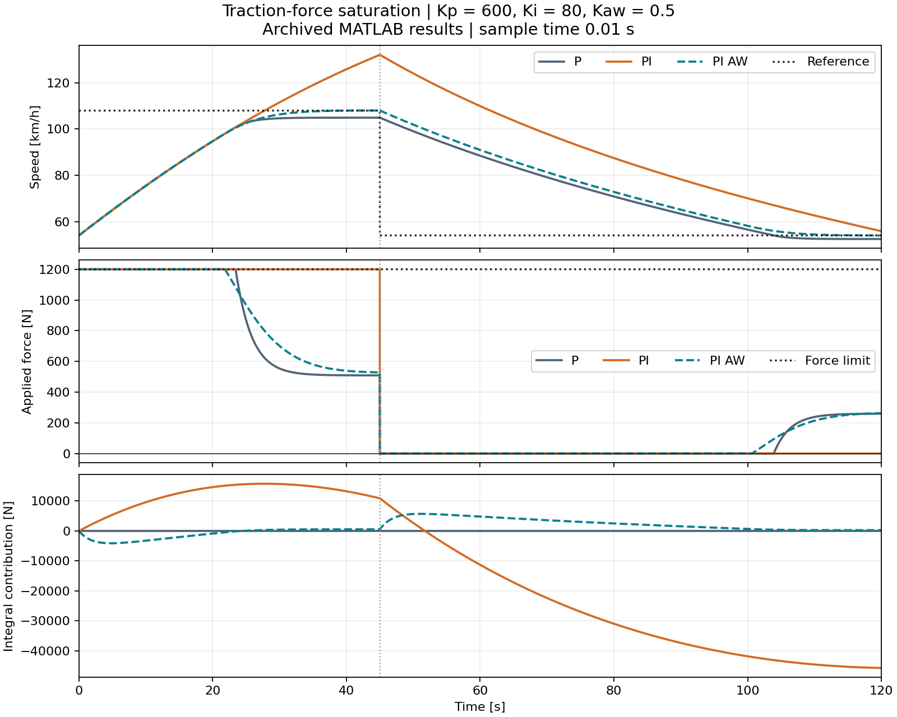

# Vehicle Speed Control — P, PI and Anti-Windup

Longitudinal vehicle speed control in MATLAB and Simulink, comparing P, PI and PI with back-calculation anti-windup under road-grade disturbances, increased mass and traction-force saturation.

**Volkan Akyazici · October 2026**

The project includes MATLAB simulations, three Simulink models, a Python numerical reference and recorded parameter experiments. MATLAB runs were completed in **R2026b (26.2.0.3386108)**. All three recorded MATLAB/Simulink comparisons passed.



## Main results

- On flat road, P settles at **70.05 km/h** for a 72 km/h reference. PI removes the steady-state offset.
- On a 5% uphill grade, P falls to approximately **65.75 km/h**. PI restores the reference by increasing the integral force contribution.
- Increasing mass from 1500 to 1950 kg increases the required uphill force and changes the transient response. PI recovers the reference with the original gains.
- With traction limited to 1200 N, plain PI reaches **132.13 km/h before the reference change**, against a 108 km/h target. PI with anti-windup peaks at **108.04 km/h**.
- Reducing Kp from 600 to 300, with Ki unchanged, increases the flat-road PI peak from **73.94 to 76.97 km/h**.
- The three MATLAB/Simulink comparisons agree to floating-point precision.

Detailed settings and observations are in [My experiments](docs/my_experiments.md). Verification scope is documented in [Validation](docs/VALIDATION.md).

## Vehicle model

The input is wheel traction force in newtons; the output is longitudinal speed. Internal units are SI, with speed converted to km/h for plotting.

$$m\dot v=F-F_{\mathrm{aero}}-F_{\mathrm{roll}}-F_{\mathrm{grade}}$$

$$F_{\mathrm{aero}}=\tfrac12\rho C_d A v|v|$$

$$F_{\mathrm{roll}}=mgC_{rr}\cos\theta\,\tanh(v/0.1),\qquad F_{\mathrm{grade}}=mg\sin\theta$$

The nominal parameters are:

- Mass: 1500 kg; heavy case: 1950 kg.
- Gravity: 9.81 m/s²; air density: 1.225 kg/m³.
- Drag coefficient: 0.29; frontal area: 2.2 m².
- Rolling-resistance coefficient: 0.012.
- Initial speed: 15 m/s (54 km/h); initial integral contribution: 0 N.
- Sample time: 0.01 s; simulation duration: 120 s.

A 5% grade is represented by $\theta=\arctan(0.05)$. The hyperbolic tangent smooths the rolling-resistance direction near zero speed; it does not model static friction. All recorded scenarios remain at positive speed.

Mass is assigned in the scenario functions: `matlab/scenario.m` and `scenario()` in `python/reference.py`. Gains and other physical constants are defined in `matlab/parameters.m` and the Python `P` dictionary.

## Controller

At each sample:

$$e_k=r_k-v_k,\qquad F_{\mathrm{raw},k}=K_p e_k+I_k$$

$$F_k=\min\!\left(\max(F_{\mathrm{raw},k},0),F_{\max,k}\right)$$

$$I_{k+1}=I_k+\Delta t\left[K_i e_k+K_{aw}(F_k-F_{\mathrm{raw},k})\right]$$

$$v_{k+1}=v_k+\frac{\Delta t}{m}(F_k-F_{\mathrm{resistance},k})$$

Both next states use the current states. The integral state $I$ is a force contribution in newtons and already includes the effect of Ki.

- **P:** Ki = 0 and Kaw = 0.
- **PI:** Ki = 80 N/m and Kaw = 0.
- **PI_AW:** Ki = 80 N/m and Kaw = 0.5 s⁻¹.
- Baseline Kp: 600 N/(m/s), reduced to 300 in the gain experiment.

When the command is within the force limits, applied force equals requested force, so the anti-windup correction is zero. Under saturation, back-calculation adjusts the integral state using the difference between applied and requested force. Both upper and lower saturation are included.

### Gain characteristics

At 20 m/s on flat road, the local resistance slope is approximately 15.631 N/(m/s). The linearized plant is `1/(m*s+b)`, and unsaturated continuous-time PI feedback has the characteristic polynomial:

`m*s^2 + (b+Kp)*s + Ki`

At nominal mass, Kp = 600 and Ki = 80 correspond to a natural frequency of approximately 0.231 rad/s and damping ratio of 0.889. Reducing Kp to 300 leaves the natural frequency unchanged in this approximation and lowers the damping ratio to approximately 0.456, consistent with the larger overshoot in the recorded experiment.

Kaw = 0.5 s⁻¹ corresponds to a back-calculation time constant of 2 s. These calculations characterize the selected gains; they are not an optimization result or a global stability proof.

## Scenarios

- **Flat:** 20 m/s reference, zero grade, 4000 N traction limit.
- **Hill:** 20 m/s reference, 5% grade from 30 s up to but excluding 70 s, 4000 N limit.
- **Heavy:** the hill case with mass increased to 1950 kg.
- **Windup:** 30 m/s reference, reduced to 15 m/s at 45 s; zero grade and a 1200 N limit.



After the reference decrease, PI_AW enters and remains within ±0.5 m/s of the target after **59.29 s**, measured from the change at 45 s. Plain PI does not remain within that band before the simulation ends at 120 s.

The vehicle has no active braking. A zero traction command slows it only through road resistance. Anti-windup improves recovery from saturation but cannot supply braking force.

## Run MATLAB

Open the repository's `matlab` directory as MATLAB's Current Folder:

```matlab
run_matlab
```

This runs all four scenarios with all three controllers and writes figures, time histories and metrics to `results/matlab/`. Repeated runs overwrite that directory; the archived experiment folders remain unchanged.

Base MATLAB is sufficient for the loop simulations.

To reproduce the lower-gain experiment, set `p.Kp=300` in `parameters.m`, run `run_matlab`, and keep the resulting files separately. Restore `p.Kp=600` before running the bundled Simulink comparisons.

## Run Simulink verification

MATLAB and Simulink are required. No Control System Toolbox, Simscape or vehicle blockset is used.

From the `matlab` directory:

```matlab
verify_simulink('hill','PI_AW')
verify_simulink('windup','PI_AW')
verify_simulink('windup','PI')
```

These commands load the bundled models, simulate them and compare speed and traction force with the MATLAB loop. The tolerances are 1e-7 m/s for speed and 1e-5 N for force.

The models use Unit Delay blocks with explicit forward-Euler state updates. Reference, grade and limit inputs use zero-order hold between samples and hold their final value after the last input sample.

The three saved `.slx` files are included in `matlab/`. The verifier loads these models; if a model file is missing, the command stops with an error.

The saved `.slx` models contain baseline parameters from R2026b. Editing `parameters.m` alone does not change their block parameters. To try different gains in Simulink, edit the blocks in the saved model and save a separate copy. Other MATLAB releases have not been tested.

## Run the Python reference

From the repository root, using Python 3.10 or later:

```bash
python -m pip install -r requirements.txt
python python/reference.py
python python/checks.py
```

Python figures and CSV files are written to `results/python/`. The numerical reference uses the same model equations and forward-Euler update order. It provides a separate implementation comparison, not an independent physical model.

### Replot the archived experiments

```bash
python python/plot_experiments.py
```

This reads the archived MATLAB CSV files and writes documentation figures to `results/figures/`. It does not rerun the model or change the recorded data. Original MATLAB exports remain in the experiment folders.

## Results and files

- `matlab/`: simulation functions, verifier and three saved `.slx` models.
- `python/`: numerical reference and model checks.
- `results/01_baseline/`: archived MATLAB runs with Kp = 600.
- `results/02_lower_kp/`: archived MATLAB runs with Kp = 300.
- `results/03_simulink_validation/`: three MATLAB/Simulink comparison figures.
- `results/python/`: Python reference results.
- `results/figures/`: readable plots generated from archived MATLAB CSV files.
- `docs/my_experiments.md`: experiment settings, findings and interpretation.
- `docs/VALIDATION.md`: execution records and verification limits.

CSV time histories contain time, reference speed, vehicle speed, applied force, requested force, integral force contribution, grade angle and force limit.

RMSE and integral absolute error (IAE) cover [0,120) using the left sample on each interval. IAE has units of metres because speed error is integrated over time. Final mean error uses samples from 115 through 120 s. Saturation duration counts intervals where the applied and requested forces differ by more than 1e-9 N.

Recovery time is measured from the reference change until entry into a ±0.5 m/s band with no subsequent exit before the end of the simulation. It is specific to this test window.

## Scope and limitations

The model uses illustrative passenger-car parameters. It has not been calibrated or validated against vehicle measurements.

Traction force follows the controller command instantaneously. The model excludes active braking, actuator lag, tire slip, drivetrain dynamics, gears, sensor noise and power-dependent force limits.

Controller performance depends on the metric. For example, P has lower whole-run speed RMSE than PI_AW in the baseline windup case (approximately 6.609 versus 6.926 m/s), while retaining a steady tracking offset. The anti-windup benefit is shown by overshoot and recovery, not by a claim of improvement in every metric.

## References

- [MathWorks: anti-windup control using a PID controller](https://www.mathworks.com/help/simulink/slref/anti-windup-control-using-a-pid-controller.html)
- [MathWorks: saving a model](https://www.mathworks.com/help/simulink/slref/save_system.html)
