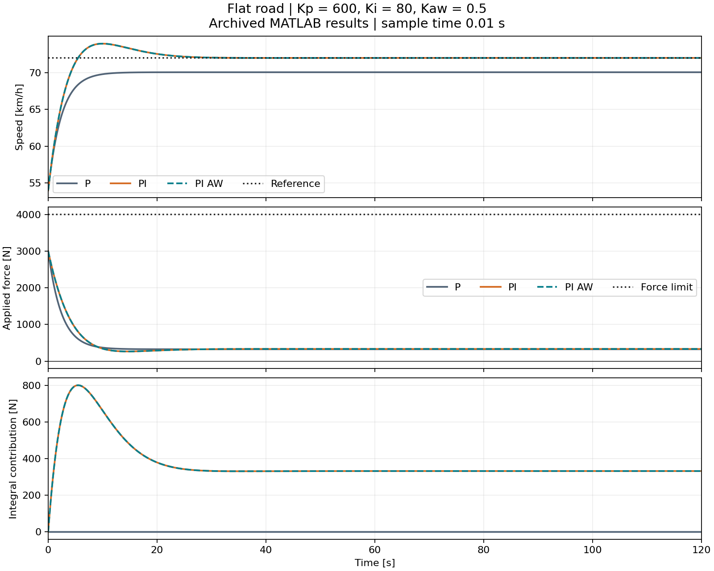
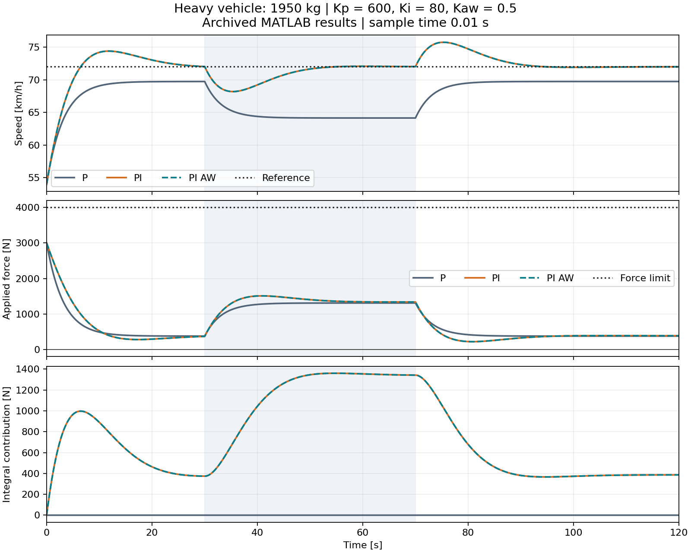
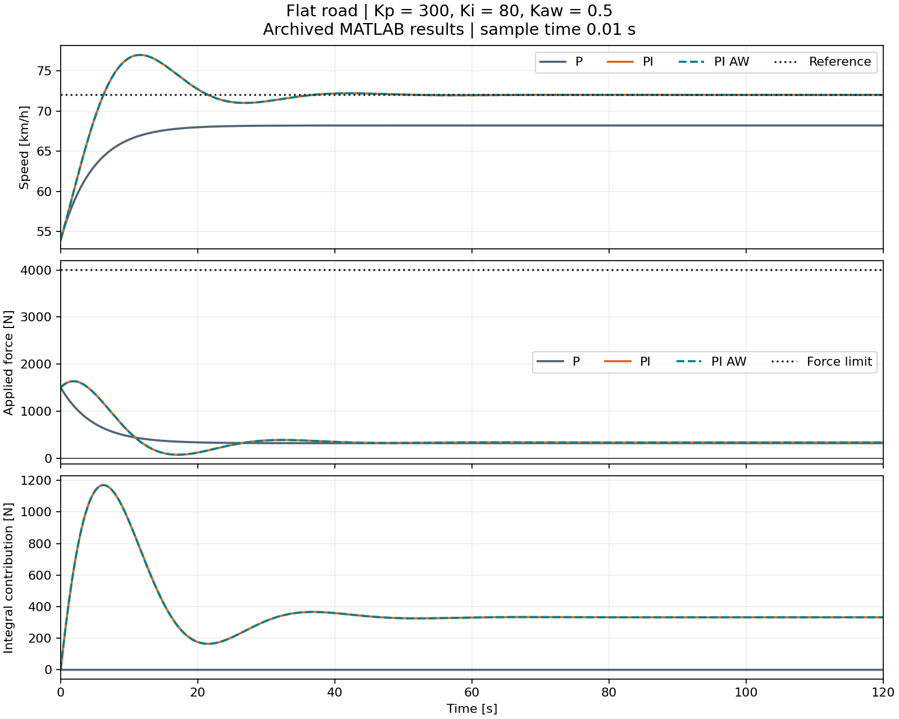
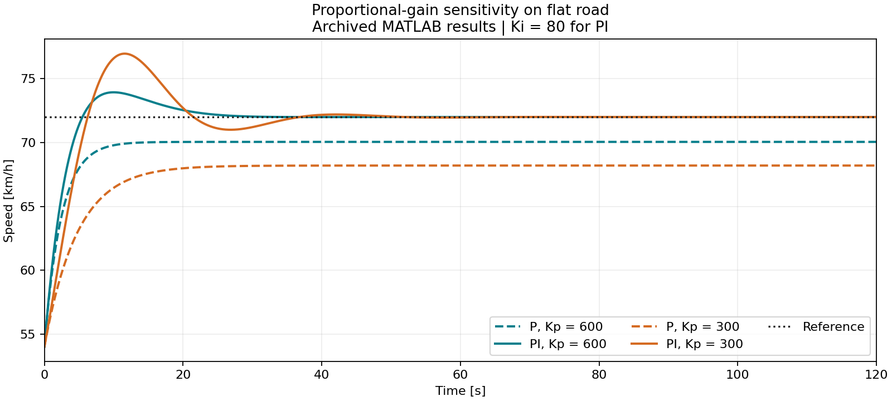
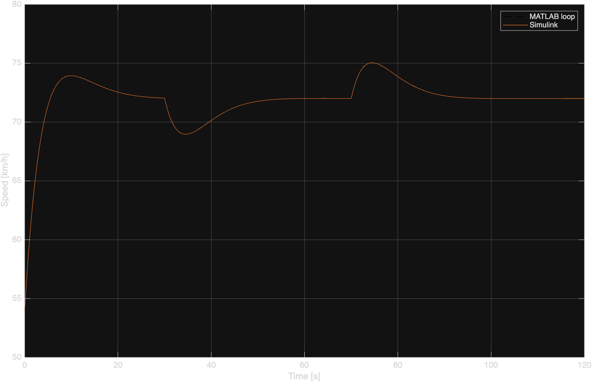
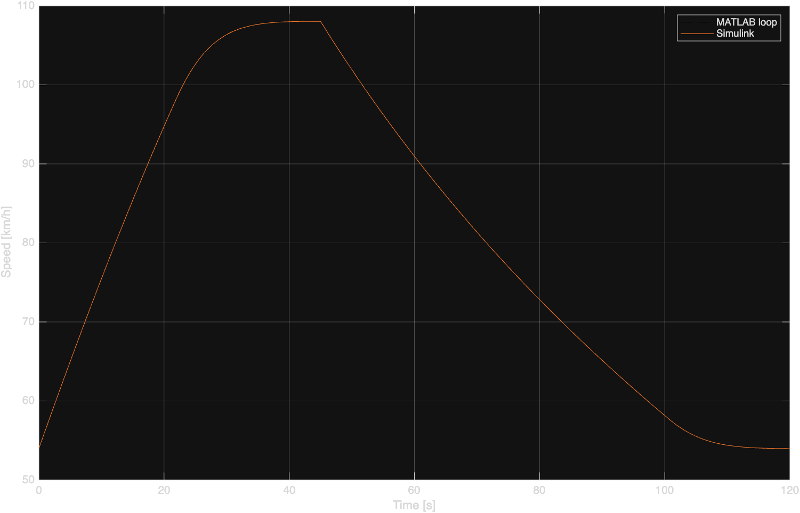
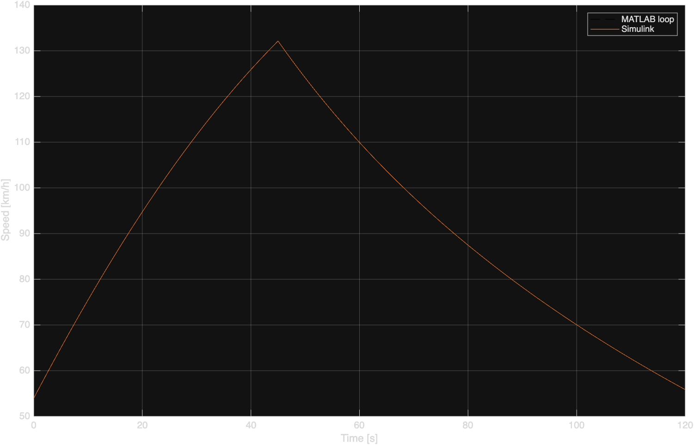

# My Experiments

**Date:** 16 October 2026  
**MATLAB:** 26.2.0.3386108 (R2026b)

This record compares P, PI and PI with back-calculation anti-windup for a longitudinal vehicle model. The experiments cover road-load disturbance rejection, mass sensitivity, proportional-gain sensitivity and agreement between MATLAB and Simulink.

## 01 — Baseline simulation

### Setup

Command: `run_matlab`

All four scenarios were run with all three controllers. The outputs are archived in `results/01_baseline/`.

- Nominal mass: 1500 kg; heavy-case mass: 1950 kg.
- Kp = 600 N/(m/s), Ki = 80 N/m and Kaw = 0.5 s⁻¹.
- P disables integral action and anti-windup; PI disables anti-windup.
- Sample time: 0.01 s; duration: 120 s.
- Initial speed: 15 m/s (54 km/h); initial integral contribution: 0 N.
- Applied traction force is bounded between zero and the scenario's upper limit.

### Flat road — Steady-state tracking

The reference was 20 m/s (72 km/h), with zero road grade and a 4000 N traction limit.

The P controller settled at 70.05 km/h, leaving approximately 0.541 m/s of steady-state error. With proportional control, a nonzero error is required to generate the force that balances aerodynamic drag and rolling resistance.

The PI controller peaked at 73.94 km/h and then settled at 72 km/h. At the reference speed, the road resistance is 332.89 N. The integral contribution supplies this force while the proportional contribution approaches zero.

When the error reaches zero and saturation is inactive, the integral contribution stops changing but retains its accumulated value. Zero error does not reset the integral state.

PI and PI_AW produced identical recorded responses. Neither force limit was active, so the back-calculation correction remained zero.

### Hill — Road-load disturbance rejection

A 5% uphill grade was applied from 30 s to 70 s while the reference remained at 72 km/h. The traction limit remained at 4000 N.

The increased resistance caused a temporary speed drop. The P controller approached 65.75 km/h during the uphill section, requiring a larger error to generate the extra traction force.

The PI speed dropped to approximately 68.96 km/h and recovered towards the reference. Its integral contribution increased from approximately 333 N to 1068 N near the end of the uphill section. The calculated equilibrium force at 72 km/h on the hill is 1067.50 N.

When the hill ended, the integral contribution initially exceeded the force required on flat road. This produced a peak of 75.04 km/h before the controller returned the speed towards the reference.

PI and PI_AW remained identical because neither force limit was active. Integral action rejected the sustained road-load disturbance, with transient speed deviations when the grade changed.

### Heavy vehicle — Mass sensitivity

Vehicle mass was increased from 1500 to 1950 kg while keeping the controller gains, reference speed and road-grade profile unchanged.

The increased mass reduced acceleration for a given net force and increased rolling resistance and uphill gravitational resistance. Aerodynamic drag at a given speed remained unchanged.

The P controller approached 64.15 km/h during the uphill section, producing a larger steady-state error than in the nominal-mass case.

The PI controller recovered towards the 72 km/h reference without retuning. The calculated force required to maintain this speed on the hill increased from 1067.50 N to 1340.86 N. At 69.99 s, the recorded integral contribution was 1342.26 N and the speed was 72.024 km/h, so the response was close to equilibrium but still settling.

Removing the hill caused an overshoot to 75.76 km/h before the speed returned towards the reference.

PI and PI_AW remained identical because neither force limit was active. The controller accommodated the tested 30% mass increase, although its transient response changed. This result applies to the tested mass and road-grade profile.

### Windup — Traction-force saturation

The traction limit was reduced to 1200 N. The reference was initially 30 m/s (108 km/h), then decreased to 15 m/s (54 km/h) at 45 s.

All three controllers initially reached the upper force limit and produced the same acceleration. Without anti-windup, PI continued accumulating integral error while the requested force exceeded the available force.

Plain PI reached 132.13 km/h before the reference change, compared with a peak of 108.04 km/h for PI_AW. At the sample at 45 s, plain PI reached 132.14 km/h before the new force command affected the next speed update.

Back-calculation adjusted the integral contribution using the difference between applied and requested force. This allowed PI_AW to reduce traction near the initial target and avoided the large overshoot seen with plain PI.

After the reference decreased, traction dropped to zero. Deceleration remained slow because the model has no active braking. Plain PI accumulated a large negative integral contribution, keeping its command below the lower force limit. Anti-windup counteracted this accumulation and allowed traction to resume near the new target.

PI_AW entered and remained within ±0.5 m/s of the new reference at 104.29 s, or 59.29 s after the reference change. Plain PI did not remain within that band before the simulation ended at 120 s.

Anti-windup improved overshoot and recovery in this case. It did not remove the physical limit on deceleration or improve every performance measure: the whole-run RMSE was approximately 6.609 m/s for P and 6.926 m/s for PI_AW.

## 02 — Lower proportional gain

### Change and purpose

Kp was reduced from 600 to 300 N/(m/s), with all other parameters unchanged. The purpose was to examine the effect of proportional gain on tracking and transient response.

Command: `run_matlab`

All four scenarios were rerun. The output files are archived in `results/02_lower_kp/`; the comparison below focuses on the flat-road case.

### Prediction

For the same error, halving Kp halves the proportional force contribution. I expected lower initial acceleration and a larger steady-state error with P-only control. PI should still remove the steady-state offset, but its transient response could change because Ki remained unchanged.

### Recorded results

The initial speed error was 5 m/s and the integral contribution was zero. Initial traction therefore fell from 3000 N to 1500 N.

P settled at 68.20 km/h instead of 70.05 km/h. Its steady-state speed error increased from approximately 0.541 m/s to 1.056 m/s.

The PI peak increased from 73.94 km/h to 76.97 km/h. The response showed more pronounced oscillation before returning to the 72 km/h reference.

PI and PI_AW remained identical in the flat-road test. The recorded applied and requested forces agreed throughout, confirming that neither force limit was active.

### Additional observations — Hill, heavy vehicle and windup

In the hill scenario, reducing Kp from 600 to 300 lowered the P-controlled uphill speed from approximately 65.75 to 59.77 km/h. The PI response showed a deeper speed drop and more pronounced oscillation following the grade changes. PI and PI_AW remained overlapping because neither force limit was active.

In the heavy-vehicle scenario, the P-controlled uphill speed decreased from approximately 64.15 to 56.64 km/h. PI continued to recover towards the reference, but the reduced proportional gain produced larger transient deviations. PI and PI_AW again remained overlapping without saturation.

In the windup scenario, the PI_AW peak increased from approximately 108.04 to 110.87 km/h. Plain PI reached approximately 134.30 km/h and briefly maintained positive traction after the reference decreased, because its accumulated integral contribution kept the requested force positive despite the negative speed error.

These results show that reducing Kp with Ki and Kaw unchanged affects both disturbance rejection and behaviour under saturation. Anti-windup still limited integral accumulation, but it did not eliminate the overshoot associated with the changed controller gains.

### Interpretation

Reducing Kp weakened the immediate correction while leaving integral action unchanged. The lower initial acceleration allowed error to persist longer, while the lower proportional contribution also provided less correction as speed approached and exceeded the reference.

The local unsaturated PI characteristic polynomial is `m*s^2 + (b+Kp)*s + Ki`. At nominal mass and 20 m/s, reducing Kp from 600 to 300 lowers the approximate damping ratio from 0.889 to 0.456 while leaving the natural frequency unchanged. This is consistent with the increased overshoot and oscillation.

Reducing Kp alone did not reduce overshoot. Kp and Ki need to be considered together when changing the transient response.

Kp was restored to 600 for the Simulink verification and the committed baseline configuration.

## 03 — MATLAB/Simulink implementation verification

The hill scenario with PI_AW and the windup scenario with both PI_AW and PI were simulated in Simulink and compared against the MATLAB loop implementation.

All three tests used the baseline gains and 0.01 s sample time. The verifier checked sample count, time alignment, speed and applied traction force. Acceptance tolerances were 1e-7 m/s for speed and 1e-5 N for force.

### Hill — PI with anti-windup

Command: `verify_simulink('hill','PI_AW')`

Result: PASS  
Maximum speed difference: 0 m/s  
Maximum traction-force difference: 0 N

### Windup — PI with anti-windup

Command: `verify_simulink('windup','PI_AW')`

Result: PASS  
Maximum speed difference: 7.11e-15 m/s  
Maximum traction-force difference: 5.91e-12 N

### Windup — PI without anti-windup

Command: `verify_simulink('windup','PI')`

Result: PASS  
Maximum speed difference: 7.11e-15 m/s  
Maximum traction-force difference: 0 N

### Interpretation

The hill test produced identical sampled outputs. The differences in the windup tests were negligible and consistent with floating-point round-off. All three tests passed the verification tolerances.

These differences measure agreement between the MATLAB and Simulink implementations, not deviation from the reference speed. The results confirm implementation consistency for these three cases; they do not establish accuracy against a real vehicle.
